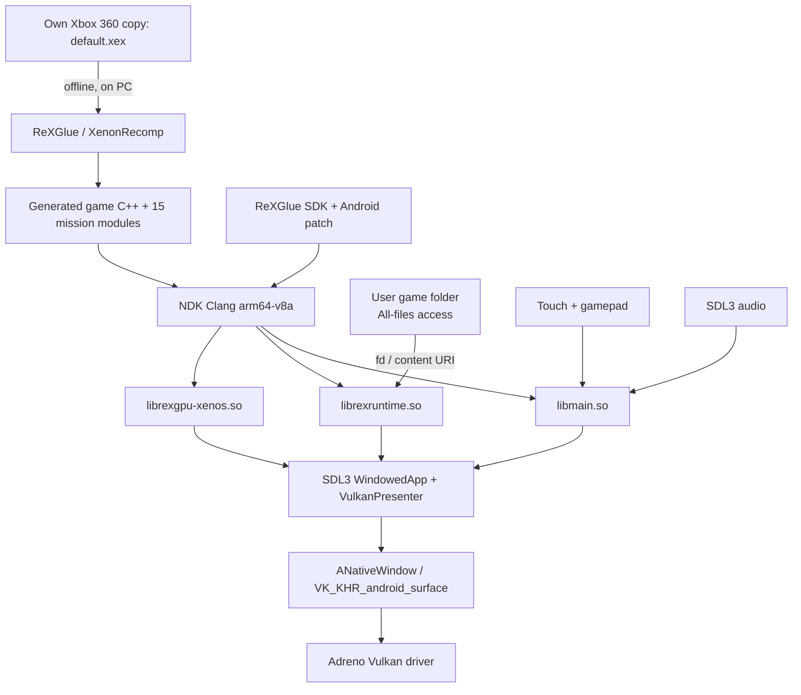

<p align="center"></p>

# Project 1944 — Android port (`cod3-android`)

**An unofficial, native ARM64 Android port of Call of Duty 3 (Xbox 360), built on static recompilation. No emulator, no JIT, no runtime translation of PowerPC code.**

This repository is the Android port of [Project 1944](https://github.com/zenit2893-cmyk/project-1944).
It inherits the Windows PC port sources from upstream and adds the Android
platform layer, the NDK/Gradle build, and the ReXGlue SDK patches required to
build the recompiled runtime for `arm64-v8a` with Vulkan output.

> **Status: early bring-up (M0b).** The APK does not contain game code yet and
> does not run Call of Duty 3. It proves the toolchain, SDL3 host, ReXGlue
> runtime and Vulkan presentation path. See [Current status](#current-status).

**Unofficial fan project. Not affiliated with or endorsed by Activision,
Treyarch, or Microsoft. No game files are included in this repository, and
none will ever be. You need your own legally obtained copy of Call of Duty 3
for Xbox 360.**

---

## Table of contents

- [What this project is](#what-this-project-is)
- [How it is possible](#how-it-is-possible)
- [Architecture](#architecture)
- [Current status](#current-status)
- [Completion estimate](#completion-estimate)
- [Requirements](#requirements)
- [Repository layout](#repository-layout)
- [Build from source](#build-from-source)
- [Install and run](#install-and-run)
- [Testing on a device](#testing-on-a-device)
- [Roadmap and TODO](#roadmap-and-todo)
- [Checklists](#checklists)
- [Known issues and risks](#known-issues-and-risks)
- [Troubleshooting](#troubleshooting)
- [Legal boundary](#legal-boundary)
- [Credits](#credits)
- [License](#license)

---

## What this project is

[Call of Duty 3](https://en.wikipedia.org/wiki/Call_of_Duty_3) shipped on Xbox 360
as PowerPC code running on a Xenos GPU. Project 1944 statically recompiles that
PowerPC code into C++ once, offline, and then compiles it into a native host
binary. The result is an ordinary native application that calls the game's own
recompiled functions directly — the original console CPU is never emulated.

This repository takes that recompiled runtime and host code and ports the
**platform layer** to Android:

| Upstream (Windows PC) | This repository (Android) |
| --- | --- |
| Win32 window, Direct3D 12 output | `SDLActivity` + SDL3 window + Vulkan (`VK_KHR_android_surface`) |
| MSVC / Clang for Windows x64 | NDK r27 Clang, `arm64-v8a` only, API 28+ |
| Win32 fibers, `VirtualAlloc`, `CreateFile` | bionic `ucontext` shims, `mmap`, POSIX filesystem, `content://` fd bridge |
| 15 level DLLs | 15 level shared objects (planned), loaded from app-private storage |
| Launcher (WPF) | Minimal Java setup screen (planned), All-files access for game data |
| DirectInput / XInput | Android gamepad + touch controls (planned) |
| WASAPI / XAudio | SDL3 audio via OpenSLES/AAudio (planned) |

The Windows PC port is the reference implementation and remains playable. This
is a separate target, not a wrapper around it.

## How it is possible

Five pieces make a native Android port feasible without an emulator:

1. **Offline static recompilation.** [XenonRecomp](https://github.com/hedge-dev/XenonRecomp)
   turns the Xbox 360 `default.xex` PowerPC code into C++ functions with explicit
   guest state. The game's own control flow becomes host code. Nothing has to
   decode PowerPC instructions at runtime, which is why no JIT and no emulator
   core are needed.
2. **A recompilation runtime instead of a console kernel.**
   [ReXGlue](https://github.com/rexglue/rexglue-sdk) provides the host-side
   runtime: guest memory, kernel exports (Xboxkrnl/NTDLL stubs), threading,
   fibers, filesystem devices, module loading and app lifecycle. The Android
   port adds the bionic-specific pieces: ucontext-based fibers on AArch64,
   `ashmem`-free shared memory, 4 KB/16 KB page-size handling, logcat logging,
   and a JNI bridge for `content://` file descriptors.
3. **GPU emulation through Vulkan.** Xenos command packets (PM4) are parsed by
   the Xenia-derived graphics layer. Shaders compiled for Xenos are translated
   to SPIR-V at runtime and submitted to the phone's Vulkan driver. On Adreno
   this is a well-supported path, which is why Snapdragon devices are the
   priority target.
4. **SDL3 as the Android host.** SDL3 owns the `SurfaceView`, the native
   `ANativeWindow`, input events, audio and lifecycle. `SDLActivity` starts a
   dedicated native thread that calls `SDL_main` in `libmain.so`; the ReXGlue
   `WindowedApp` runs its message loop on that thread.
5. **Data stays where the user put it.** Game data is read in place from a
   user-selected folder using `MANAGE_EXTERNAL_STORAGE`, with `content://` URIs
   resolved to raw file descriptors when a document provider is involved. No
   game data is copied into the repository or the APK.

Everything is ordinary Clang/NDK, CMake and Gradle — the hard part is the
graphics and platform glue, not the build system.

## Architecture



APK composition today (M0b, debug):

```
lib/arm64-v8a/libmain.so          SDL_main + rex::ui objects (window, presenter)
lib/arm64-v8a/librexruntime.so    ReXGlue runtime + statically linked SDL3
lib/arm64-v8a/librexgpu-xenos.so  Xenos GPU emulation (built, not loaded yet)
lib/arm64-v8a/libc++_shared.so    NDK LLVM libc++ (shared STL)
```

## Current status

**M0b — ReXGlue runtime + Vulkan presenter.** Verified on the build host:

- ReXGlue SDK cross-builds for `arm64-v8a` (`rexcore`, `rexui`, `rexruntime`,
  full SDK build) with the Android patch applied.
- `libmain.so` links `rex::ui` as an object library and `librexruntime.so` as a
  shared dependency; symbols `SDL_main`, `VulkanProvider::Create` and the
  Vulkan presenter are present.
- The APK builds, packages all four native libraries, and declares
  `com.project1944.cod3` with `versionName = 0.1.0-m0b`.
- The app opens a `WindowSDL`, creates a Vulkan provider and presenter, attaches
  the presenter to the `ANativeWindow`, and requests a paint every ~16 ms. With
  no guest image, the presenter clears the swapchain to black and presents.
- Logs every two seconds: `Project1944App: ... paint requests/s`.

**Not yet verified:** none of the on-device behaviour. There is no Android
device attached to the build machine, so the black swapchain, Vulkan device
selection, pause/resume surface re-creation and thermals are unproven.

**Not implemented:** reading game data, generating or loading the 15 mission
modules, booting the guest, rendering game frames, touch controls, audio,
save/load, setup UI, release signing.

## Completion estimate

Weighted engineering estimate, based only on source-level progress. It is not a
promise, and it does not include on-device validation, which is currently 0%.

| Milestone | Scope | Weight | Status | Contribution |
| --- | --- | ---: | --- | ---: |
| M0 | Toolchain, SDK cross-build, SDL3/Vulkan bootstrap, presenter | 15% | done | 15.0% |
| M1 | Android platform glue: filesystem, `content://`, plugin loading, input, audio | 15% | partial (~40% written, untested) | 6.0% |
| M2 | Boot recompiled guest, load 15 mission modules | 25% | scaffolding only | 1.0% |
| M3 | First rendered game frame through Xenos → SPIR-V → Vulkan | 20% | not started | 0% |
| M4 | Touch controls, controller, audio, save/load | 15% | not started | 0% |
| M5 | Performance, stability, pause/resume, packaging, release build | 10% | not started | 0% |
| **Total** | | **100%** | | **≈ 22%** |

What moves the number fastest:

- M1 + M2 on a real device: +14 points if the guest boots and modules load.
- M3: +20 points, the single largest risk (mobile Vulkan driver coverage).
- Device validation of M0b: small weight, but it is the gate for everything else.

## Requirements

### Phone

| Component | Requirement |
| --- | --- |
| CPU | ARM64 (`arm64-v8a`), Snapdragon recommended |
| GPU | Vulkan 1.3-capable driver; Adreno prioritized |
| RAM | 6 GB minimum, 8 GB recommended |
| Android | 9 (API 28) or newer, target API 35 |
| Storage | Game data read in place; ~1 GB free for app data and shader caches |
| Permissions | All-files access (`MANAGE_EXTERNAL_STORAGE`) to read the game folder |

The manifest declares `android.hardware.vulkan.version = 0x00400003` (Vulkan 1.3)
as required. Devices without Vulkan 1.3 will not be offered the APK by the
installer.

### Build host

| Component | Version used |
| --- | --- |
| JDK | 17 |
| Android SDK | API 35, build-tools 35.x |
| NDK | 27.3.13750724 |
| CMake | 3.30.5 (SDK copy is fine) |
| Gradle | wrapper 8.10.2 |
| AGP | 8.7.3 |

### Game

| Item | Value |
| --- | --- |
| Title | Call of Duty 3 (Xbox 360, USA/Europe) |
| Title ID | `415607E1` |
| Media ID | `2E07093A` |
| Supported `default.xex` SHA-256 | `2944EEC7D1231AD6798B5F9FADF8855F5E489296B22EAB45B27A577CEE23692` |

Any other revision is untested and may produce broken generated code.

## Repository layout

```
android/
  app/
    build.gradle.kts                 Android module (minSdk 28, target 35, arm64)
    src/main/AndroidManifest.xml     Permissions, Vulkan/gamepad features, activities
    src/main/java/com/project1944/cod3/
      MainActivity.java              Launcher / diagnostics screen
      GameActivity.java              SDLActivity host + content:// fd bridge
    src/main/java/org/libsdl/app/    Official SDL3 Android Java glue (zlib)
    src/main/cpp/
      CMakeLists.txt                 SDK cross-build + libmain.so
      src/main.cpp                   WindowedApp, Vulkan provider/presenter, paint loop
  patches/
    rexglue-android.patch            All Android changes to the pinned SDK
    apply-sdk-patch.ps1              Apply after a fresh submodule checkout
    export-sdk-patch.ps1             Regenerate after editing the SDK
  scripts/
    build-debug.ps1                  Configure + assembleDebug
    install-debug.ps1                adb install + launch
    logcat.ps1                       Filtered logcat
    doctor.ps1                       Device/feature/permission checks
  README.md                          Android-specific notes
cod3-pc/                             Upstream Windows host sources
integration/                         Upstream runtime patches and packaging
launcher/                            Upstream WPF launcher and artwork
scripts/, analysis/, tests/          Upstream tooling and verification
tools/rexglue-source                 ReXGlue SDK submodule (pinned, patched)
tools/XenonRecomp, tools/XenosRecomp Upstream recompilers (submodules)
tools/Xenia-source                   GPU/kernel reference (submodule)
docs/                                Player guides and engineering log
```

The SDK submodule is pinned to `0c7b01a0ac0479801757507d80533f662fa0815d`.
All Android changes to it live in `android/patches/rexglue-android.patch`
(22 files, +881/−37 at the time of writing), so a fresh checkout plus the patch
reproduces the build.

## Build from source

### 1. Prepare the toolchain and submodules

```powershell
git submodule update --init --recursive --depth 1 tools/rexglue-source
git -C tools/rexglue-source submodule update --init --depth 1 `
    thirdparty/sdl3 thirdparty/vulkan-headers thirdparty/vulkan-memory-allocator `
    thirdparty/spirv-headers thirdparty/spirv-tools thirdparty/glslang
.\android\patches\apply-sdk-patch.ps1
```

Set `ANDROID_HOME` (or rely on `android/local.properties`) to an SDK with
API 35, build-tools 35.x and NDK `27.3.13750724`.

### 2. Build the APK

```powershell
.\android\scripts\build-debug.ps1
```

Output: `android/app/build/outputs/apk/debug/app-debug.apk`.

Equivalent manual build:

```powershell
cd android
.\gradlew.bat :app:assembleDebug --console=plain
```

Notes:

- The ReXGlue CMake files are patched to use `${CMAKE_CURRENT_SOURCE_DIR}` for
  versioning and to leave a parent-provided `CMAKE_*_OUTPUT_DIRECTORY` alone, so
  Gradle owns the packaging directory.
- NDK r27's libc++ (LLVM 18) lacks `std::jthread`, `std::stop_token` and
  `std::chrono::clock_cast`; the patch adds `rex/thread/jthread_compat.h`.
- bionic has no robust mutexes, no `linux/ashmem.h` and no ucontext API; the
  patch adds Android implementations.
- `g_guest_phys_host_offset` is computed at runtime because Android page size may
  be 4 KB or 16 KB.

### 3. Regenerate the SDK patch (only if you edit the SDK)

```powershell
.\android\patches\export-sdk-patch.ps1
```

Never commit the submodule's modified working tree. Commit the patch.

### 4. Release signing (future)

The current APK is `assembleDebug`, signed with the debug key. A personal
release build needs a keystore and a `signingConfigs` block; no keystore is
committed to this repository.

## Install and run

```powershell
.\android\scripts\doctor.ps1
.\android\scripts\install-debug.ps1
.\android\scripts\logcat.ps1
```

Manual equivalent:

```powershell
adb install -r android\app\build\outputs\apk\debug\app-debug.apk
adb shell am start -n com.project1944.cod3/.MainActivity
```

Expected on a working M0b device:

- a black screen (cleared swapchain), landscape, edge-to-edge;
- logcat lines tagged `project1944` with the SDL video driver, the selected
  Vulkan device, `Project1944App: initialized, presenting`, and
  `paint requests/s` every two seconds;
- no crash when backgrounding and returning.

The launcher screen shows a start button that opens `GameActivity`. Game data
selection does not exist yet.

## Testing on a device

Current checklist for validating M0b hardware behaviour:

- [ ] `adb devices` lists the phone and `doctor.ps1` reports Vulkan 1.3.
- [ ] APK installs (`arm64-v8a`, API 28+).
- [ ] App opens without a native crash; no `dlopen`/`JNI_OnLoad` errors.
- [ ] Vulkan provider selects a physical device and queues a present-capable family.
- [ ] `paint requests/s` stabilises near 60.
- [ ] Screen is black, not garbage or a stale buffer.
- [ ] Home then resume: swapchain reattaches, painting continues.
- [ ] Rotation/lock: no device loss; if it breaks, capture the logcat.
- [ ] 10-minute run: no thermal shutdown, no memory growth.

Attach the relevant `logcat` slice and device model/driver version to any
report. Do not upload game files.

## Roadmap and TODO

### M0 — Bootstrap (done)

- [x] arm64-v8a Gradle/NDK project, minSdk 28, target 35
- [x] SDL3 static build into `libmain.so`, SDLActivity Java glue
- [x] ReXGlue SDK cross-build for Android, all targets
- [x] Android SDK patch exported and reverse-apply verified
- [x] `WindowedApp`, Vulkan provider, presenter, `VK_KHR_android_surface`
- [x] Continuous paint loop and swapchain clear
- [x] APK packaging and symbol checks
- [x] `content://` fd JNI bridge (native side)
- [ ] On-device validation of M0b

### M1 — Android platform glue (in progress)

- [x] ucontext AArch64 fibers
- [x] Page-size-independent guest memory offset
- [x] logcat logging backend
- [x] Native library directory discovery without JNI
- [x] `openContentFd` bridge on the Java side
- [ ] Game folder picker and persisted All-files access
- [ ] Game data validation (`default.xex` SHA-256, Title ID)
- [ ] Load `librexgpu-xenos.so` from `nativeLibraryDir` and verify the plugin ABI
- [ ] Shader cache directory under app storage
- [ ] Gamepad mapping, touch overlay skeleton
- [ ] SDL audio device selection and buffer sizing
- [ ] Pause/resume handling for graphics and audio

### M2 — Guest boot and mission modules (not started)

- [ ] Generate game C++ on the PC for the supported XEX
- [ ] Build 15 mission modules as `arm64-v8a` shared objects
- [ ] Load/unload modules without leaking guest memory
- [ ] Kernel export coverage audit on Android
- [ ] Boot to the main menu
- [ ] Save/load and checkpoint files under app storage

### M3 — Rendering (not started)

- [ ] First frame from the guest output image
- [ ] Xenos → SPIR-V translation on Adreno
- [ ] Resolve/copy paths, EDRAM emulation, predicated tiling
- [ ] Correct texture formats and gamma
- [ ] Frame pacing and vsync behaviour
- [ ] Fix known grass/geometry artefacts inherited from the PC port

### M4 — Controls, audio, saves (not started)

- [ ] Touch look/move sticks, fire/aim, reload, grenade, melee, QTE
- [ ] Physical gamepad with correct deadzones and prompts
- [ ] Audio output and latency tuning
- [ ] Suspend/resume with audio focus
- [ ] Settings persistence

### M5 — Performance and release (not started)

- [ ] Profile guest, GPU translation and presentation separately
- [ ] Shader/pipeline cache warm-up and persistence
- [ ] Thermal and memory limits; 6 GB device profile
- [ ] Signed release APK, versioning, update path
- [ ] Test matrix: at least one Adreno and one Mali device

## Checklists

### Build checklist

- [ ] Submodules at the pinned commits
- [ ] `apply-sdk-patch.ps1` applied cleanly
- [ ] `ANDROID_HOME`, NDK, CMake, JDK 17 available
- [ ] `build-debug.ps1` finishes with `BUILD SUCCESSFUL`
- [ ] APK contains `libmain.so`, `librexruntime.so`, `libc++_shared.so`, `librexgpu-xenos.so`
- [ ] `llvm-nm` shows `SDL_main` and `VulkanProvider::Create` in `libmain.so`
- [ ] `export-sdk-patch.ps1` run after any SDK edit and reverse-apply verified

### Device checklist

- [ ] All-files access granted
- [ ] Vulkan 1.3 reported by `doctor.ps1`
- [ ] Black swapchain, stable `paint requests/s`
- [ ] Background/resume survives
- [ ] 10-minute stability run
- [ ] Logcat captured for the session

### Release checklist

- [ ] Version bumped in `android/app/build.gradle.kts`
- [ ] Keystore created and kept outside the repository
- [ ] `assembleRelease` signed and verified
- [ ] SHA-256 recorded next to the APK
- [ ] APK uploaded only to the private release repository
- [ ] No game data, generated C++ or `.so` with game code published

## Known issues and risks

| Risk | Impact | Mitigation |
| --- | --- | --- |
| No device validation yet | Everything on-device is unproven | Run the device checklist first |
| Mobile Vulkan driver coverage | Rendering may fail or corrupt on some GPUs | Adreno-first, feature probing, validation layers on debug builds |
| Xenos → SPIR-V cost on mobile | Long shader compiles, stutter | Pipeline cache, warm-up, reduced draw distance later |
| 16 KB page size (Android 15+) | Wrong guest memory offsets, crashes | Runtime page-size detection already in the SDK patch; needs a 16 KB test device |
| 6 GB RAM floor | Guest memory + GPU caches may not fit | Measure real usage; expose memory settings |
| Surface destroy/recreate | Stale `ANativeWindow` after pause | Reattach logic exists; verify and harden |
| Thermal throttling | Frame time spikes on long sessions | Frame cap, quality settings |
| Missing launcher flow | No way to point the app at game data yet | M1 picker + verification |
| Inherited PC-port bugs | Grass strips, untested levels | Track upstream issues; do not regress |

## Troubleshooting

| Symptom | Check |
| --- | --- |
| `UnsatisfiedLinkError` / `dlopen failed` | APK ABI is `arm64-v8a`; device is 64-bit; all four libs packaged |
| `JNI_OnLoad` / `SDL_GetAndroidActivity` crash | SDL's `JNI_OnLoad` lives in `librexruntime.so`; verify it is packaged and loaded before `SDL_main` |
| `SDL_InitSubSystem(SDL_INIT_VIDEO) failed` | Run on the UI thread started by `SDLActivity`; check logcat for the SDL driver |
| No Vulkan device | `doctor.ps1`; driver must expose Vulkan 1.3 and a present-capable queue |
| Black screen but no paint logs | Presenter did not attach: check `ANativeWindow` pointer and surface size |
| Paint logs but nothing visible | Swapchain is cleared to black by design in M0b |
| Build fails in `rex_version.cmake` | Patch not applied, or `SOURCE_DIR` fix missing |
| `librexruntime.so` missing from APK | Check the CMake output directory; Gradle must own `obj/arm64-v8a` |
| Gradle cannot find CMake 3.30.5 | Install it from SDK Manager or point `cmake.dir` at the SDK copy |

## Legal boundary

This repository contains **source code only**. It must never contain:

- `default.xex`, mission XEXs, ISOs, GOD containers, or extracted assets;
- generated or recompiled game C++;
- APKs, `.so` files or other binaries containing game-derived code or data;
- keys, tokens or personal paths.

The user supplies their own legally obtained game. Builds are private and for
personal use. Do not distribute game-derived binaries; distribute the source and
the builder instead. The game and its assets remain the property of Activision,
Treyarch and Microsoft.

The upstream Windows PC port has its own legal notes in
[docs/legal.md](docs/legal.md) and
[integration/release-packaging/THIRD-PARTY-NOTICES.md](integration/release-packaging/THIRD-PARTY-NOTICES.md).

## Credits

This port would not exist without the work below. Thank you.

### Upstream project

- **Project 1944** — [zenit2893-cmyk](https://github.com/zenit2893-cmyk/project-1944):
  the Windows PC port, launcher, build scripts, documentation and the
  recompilation pipeline this port is derived from.
- **GenryTheFox** ([GenryTheFox0](https://github.com/GenryTheFox0)) — help with
  the Call of Duty 3 PC port and testing; author of Project 2099 and Project
  Iron 6.

### Recompilation and runtime

- **[ReXGlue SDK](https://github.com/rexglue/rexglue-sdk)** (BSD-3-Clause),
  maintained by **Tom Clay** and contributors — runtime, kernel exports, window
  and graphics abstractions, Vulkan presenter, SDL3 host, code generation.
- **[Xenia](https://github.com/xenia-project/xenia)** and
  **[Xenia Canary](https://github.com/xenia-canary/xenia-canary)**
  (BSD-3-Clause), originally by **Ben Vanik** and contributors — kernel and
  graphics emulation, Xenos command processor, shader translation.
- **[XenonRecomp](https://github.com/hedge-dev/XenonRecomp)** by **hedge-dev** —
  PowerPC to C++ static recompiler.
- **[XenosRecomp](https://github.com/hedge-dev/XenosRecomp)** by **hedge-dev** —
  Xenos shader recompilation tooling.
- **Community Android ports of ReXGlue-based games**, including
  **deivid22srk**'s hells-gate-android — architectural reference for the Android
  entry point, JNI setup and lifecycle. No code is copied; the port here is
  written against the pinned SDK.

### Graphics and platform

- **[SDL3](https://github.com/libsdl-org/SDL)** (zlib) by **Sam Lantinga** and
  contributors — window, input, audio, Android host, `SDLActivity` Java glue
  (pinned at `147a8ee32dbf9ac02f3794964490687b6bbda1bc`).
- **[Vulkan](https://www.vulkan.org/)** — Khronos Group; Vulkan-Headers
  (Apache-2.0), Vulkan Memory Allocator (MIT), SPIRV-Headers, SPIRV-Tools and
  glslang (Apache-2.0 / BSD-style, see upstream).
- **AMD FidelityFX** (MIT) — optional upscaling/CAS in the presenter; disabled in
  this build.
- **Dear ImGui** (MIT) — overlay UI in the SDK.
- **fmt** (MIT), **spdlog** (MIT), **xxHash** (BSD-2-Clause) — formatting,
  logging and hashing.
- **FFmpeg** and **libmspack** — video/audio and container support in the SDK and
  packaging (LGPL terms, see upstream notices).

### Toolchain

- **LLVM/Clang** (Apache-2.0 with LLVM exception), **CMake** (BSD-3-Clause),
  **Ninja** (Apache-2.0), **Gradle** (Apache-2.0), **Android Gradle Plugin**
  (Apache-2.0), **Android NDK** and **Android SDK** (Apache-2.0), **GNU
  binutils**, **PowerShell/WPF**, **adb**.
- **xdvdfs** by **antangelo** and **PortableMSVC** by **tgbender** — upstream
  packaging tools.
- **Bionic** (Android C library) — the platform quirks the Android patch works
  around.

### Third-party notices

- `android/THIRD_PARTY_NOTICES.md` — SDL3 Android glue and ReXGlue/Xenia notices.
- `integration/release-packaging/THIRD-PARTY-NOTICES.md` — upstream bundled
  components.
- `licenses/xenia/LICENSE` — Xenia's original BSD-3-Clause notice.

## License

Project-authored source code is offered under
[BSD-3-Clause](LICENSE). Upstream and bundled components keep their own licenses;
the Xenia notice is preserved in `licenses/xenia/LICENSE`. The Android SDK patch
is distributed under the same BSD-3-Clause terms as the code it modifies.

The game and its assets remain the property of their respective owners. This
project is free, unofficial, and does not sell game content.
